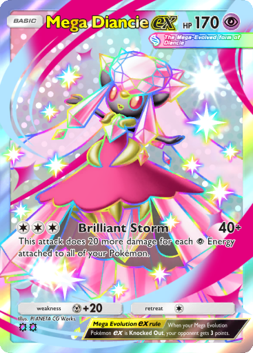
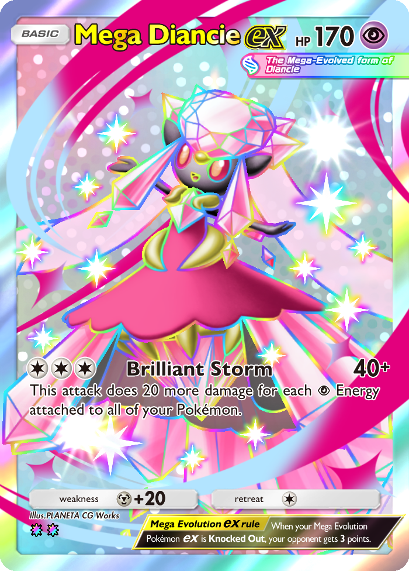

# TCG Render

Export Pokémon TCG Pocket collections as **700 × 976 PNGs with transparency**, assembled from the game's resources on your computer.

The app has an English command-line interface and exports card text in **English, Brazilian Portuguese or Japanese**, individually or together.

[How it works](#how-it-works) · [Requirements](#requirements) · [Installation](#installation) · [Credits](#credits)

## How it works

1. **Import:** read the game APKs and downloaded resources from BlueStacks into a local snapshot.
2. **Discover:** read the imported card database, translations and resource catalog to find collections and their cards.
3. **Assemble:** combine the original artwork, models, materials, fonts and interface elements for each card.
4. **Render:** use Vulkan and the original shader programs to export the large card presentation as a static PNG.

This is resource-based rendering. The app does not capture screenshots, use AI enhancement or enlarge a finished low-resolution card image. Transparent areas depend on the card's original shape and presentation.

### Visual comparison

**Mega Diancie ex — B4b-427, English.** Both images below are exported files, displayed at the same width for comparison. Click an image to inspect its original resolution.

<table>
  <tr>
    <th>Original game medium presentation</th>
    <th>TCG Render large presentation</th>
  </tr>
  <tr>
    <td align="center"><a href="docs/images/mega-diancie-game-367x512.png"></a></td>
    <td align="center"><a href="docs/images/mega-diancie-render-700x976.png"></a></td>
  </tr>
  <tr>
    <td align="center">367 × 512 pixels</td>
    <td align="center">700 × 976 pixels</td>
  </tr>
</table>

The left image is the game's stored **medium presentation**, exported from its resources; it is not a screenshot or a claim about the game's maximum resolution. The right image is assembled from the large presentation's resources and contains about **3.6 times as many output pixels**. These sample files have not been resized or sharpened. Different presentations can also differ in layout and effects, so this comparison does not imply that every visual difference is caused by resolution.

The output is a static frontal render. Animated effects and exact equivalence with the complete in-game presentation are outside the current scope. Unsupported resources or layouts are reported in the export's JSON metadata.

## Requirements

| Requirement | Details |
| --- | --- |
| Windows | The included launchers and decoder executables are for Windows. |
| Python 3.9 or newer | Install Python before running setup, with the Python launcher or `python` available from the command line. |
| Vulkan-capable GPU and driver | Required for rendering. Tested on an NVIDIA RTX 3060; other GPUs have not been individually validated. There is no CPU rendering fallback. |
| BlueStacks with Pokémon TCG Pocket | Install the game and finish downloading its additional resources. The APK alone is insufficient. |
| ADB enabled in BlueStacks | Enable **Settings → Advanced → Android Debug Bridge (ADB)** for import. |
| Internet access | Needed to install Python dependencies and download the game's resources. |
| Free disk space | Allow several GB for imported resources, preparation caches and exported collections. Usage varies by installation. |

BlueStacks must remain open during ADB import. **It can be closed after the import finishes**, including while cards are being rendered.

## Installation

### 1. Download the project and install Python

Download this repository using **Code → Download ZIP** and extract it, or clone it with Git. Keep the complete folder structure. A short folder path, such as `C:\TCG-Render`, helps avoid Windows path-length issues.

Install [Python for Windows](https://www.python.org/downloads/windows/) if it is not already installed. Enable the Python launcher or add Python to `PATH` during installation.

### 2. Run setup

Open **`setup.cmd`** in the project folder. It creates a local `.venv` environment and installs all Python dependencies from [requirements.txt](requirements.txt):

- UnityPy
- Pillow
- lz4
- vulkan
- freetype-py

Wait for **“Environment ready”**. Setup installs these packages automatically; Python, BlueStacks and your graphics driver must be installed separately. The required Windows resource and shader decoder executables are included in the repository.

### 3. Prepare the game source

1. Start BlueStacks and open Pokémon TCG Pocket.
2. Finish downloading the game's additional resources.
3. Enable ADB in BlueStacks settings.
4. Close the game and leave BlueStacks running during import, so the source files remain stable.

### 4. Launch and export

1. Open **`start.cmd`**.
2. Follow the source prompt: enter the BlueStacks installation folder or press **A** to search automatically.
3. Import the source, then choose **Export collection**.
4. Select the collection.
5. Choose **Entire collection** (the default), **Specific cards** or **By rarity**. For specific cards, enter numbers, numeric ranges or full IDs, such as `1, 8, 20-25` or `B4b-041 B4b-101`. Only cards from the selected collection are accepted; repeated entries are exported once. **By rarity** lists the rarities present in that collection with their card counts; select one to export only those cards. Categories come from the imported game's rarity data.
6. Select the card language: **English** is the default; the other menu choices are **Portuges(Brazil)**, **Japanese** and **All three**.
7. Accept the default output folder or choose another destination, and wait for the export to finish.

The app automatically uses the large **700 × 976** presentation. Existing valid PNGs are skipped. To regenerate existing exports from the command line, use the export command's `--overwrite` option; available commands are listed by:

```powershell
.venv\Scripts\python.exe render_cards.py --help
```

## Where files are saved

By default, `tcg-data` is created **next to the application folder**, rather than inside the repository:

```text
your-folder/
├── pocket-renderer/              # Application / GitHub repository
│   ├── setup.cmd
│   ├── start.cmd
│   └── ...
└── tcg-data/
    └── <snapshot>/
        ├── ...                  # Imported resources and prepared data
        ├── renders/
        │   └── <language>/<collection>/<card>.png
        └── renders-metadata/
            └── <language>/<collection>/<card>.json
```

Card metadata and batch reports are kept separately from the PNGs. A custom output folder also gets a separate metadata folder beside it: for example, `my-cards` and `my-cards-metadata`.

## New collections and game updates

After a game update, download the new resources in Pocket and choose **Update/import or choose another source** in TCG Render. Compatible new collections are discovered from the imported database; there is no fixed list of collections to edit manually.

Existing snapshots do not update themselves. Changes to game binaries, resource formats, shaders or layouts may require an application update, so compatibility with every future game version cannot be guaranteed.

## Credits

TCG Render's application workflow, importer integration and card assembly were developed for this project. The project also uses the following third-party code, tools, algorithms and format research. It is **not entirely original code**; these projects made the implementation possible.

### Tools, code and format references

| Project | GitHub author / organization | Contribution used here |
| --- | --- | --- |
| [aladump](https://github.com/SombrAbsol/aladump) | [@SombrAbsol](https://github.com/SombrAbsol) | Bundled resource extractor. Its [Aladin format documentation](https://github.com/SombrAbsol/aladump/blob/main/docs/aladin.md) also informed the master-data decoder. |
| [kvrom2json](https://github.com/SombrAbsol/kvrom2json) | [@SombrAbsol](https://github.com/SombrAbsol) | [KVROM format documentation](https://github.com/SombrAbsol/kvrom2json/blob/main/docs/kvrom.md), used as a reference for this project's localization decoder. The kvrom2json executable is not bundled. |
| [SMOL-V](https://github.com/aras-p/smol-v) | [@aras-p](https://github.com/aras-p) — Aras Pranckevičius | Source included in the shader helper to decode SMOL-V into SPIR-V. |
| [SPIRV-Cross](https://github.com/KhronosGroup/SPIRV-Cross) | [@KhronosGroup](https://github.com/KhronosGroup) and contributors | Source included in the shader helper to produce GLSL for inspection. GPU rendering uses the original SPIR-V shader programs. |
| [xxHash](https://github.com/Cyan4973/xxHash) | [@Cyan4973](https://github.com/Cyan4973) — Yann Collet | Hash algorithm used to check master-data integrity, and a dependency covered by aladump's bundled third-party notices. |

### Python dependencies

| Project | GitHub author / organization | Role |
| --- | --- | --- |
| [UnityPy](https://github.com/K0lb3/UnityPy) | [@K0lb3](https://github.com/K0lb3) and contributors | Read Unity assets and bundles. |
| [Pillow](https://github.com/python-pillow/Pillow) | [@python-pillow](https://github.com/python-pillow) and contributors | Image processing and PNG output. |
| [python-lz4](https://github.com/python-lz4/python-lz4) | [@python-lz4](https://github.com/python-lz4) and contributors | LZ4 decompression. |
| [vulkan](https://github.com/realitix/vulkan) | [@realitix](https://github.com/realitix) and contributors | Python bindings for Vulkan rendering. |
| [freetype-py](https://github.com/rougier/freetype-py) | [@rougier](https://github.com/rougier) and contributors | Font metrics and glyph rendering. |

These handles identify upstream authors or organizations; credit also belongs to their contributors. See each upstream repository for its complete contributor list and license.

Bundled component licenses and provenance are preserved in the repository:

- [aladump license](tools/aladump/LICENSE) and [third-party notices](tools/aladump/THIRD_PARTY_NOTICES.txt).
- [SMOL-V source and license notices](native/original-shader-decoder/smolv/smolv.cpp).
- [SPIRV-Cross license](native/original-shader-decoder/spirv-cross/LICENSE).
- [Bundled tool hashes and upstreams](tools/manifest.json) and [shader source revisions](native/original-shader-decoder/upstream-sources.json).

### Game artwork and resources

Pokémon TCG Pocket artwork, card designs, text, fonts, models and shaders belong to their respective rights holders. They are game resources, not artwork created by TCG Render. This is an unofficial project and is not affiliated with or endorsed by the game's creators.

Runtime game data is imported from the user's local installation. APKs, resource snapshots, caches and generated collections are excluded from version control. The two card images in `docs/images` are included as documentation examples for the comparison above.
